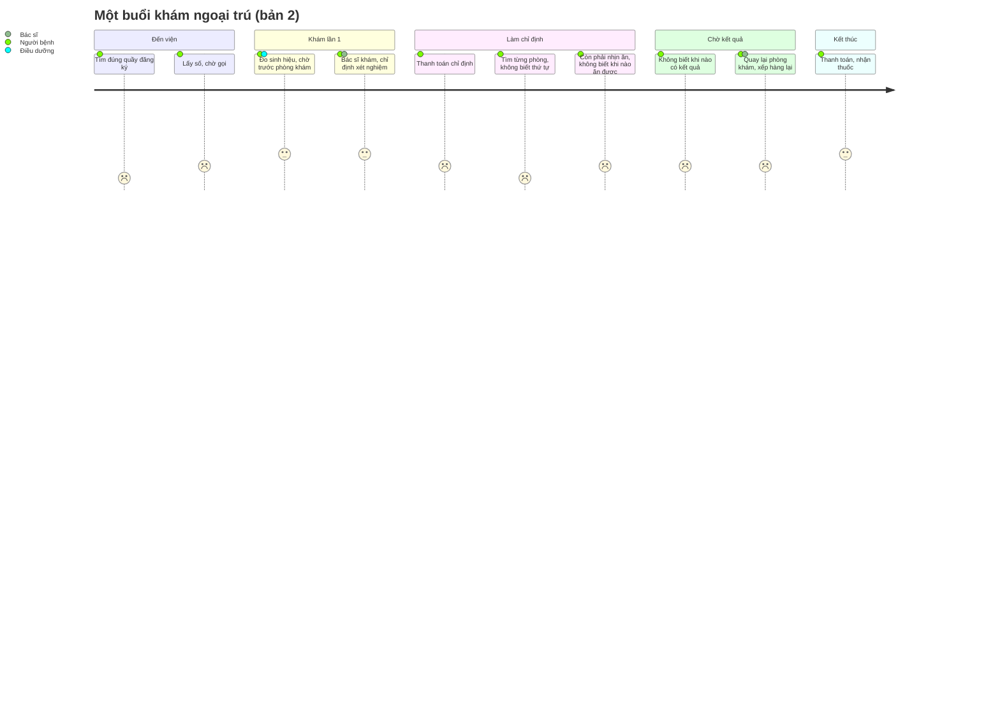

# Journey map (bản 2, 18/10/2026): một buổi khám ngoại trú, từ cửa viện tới lúc nhận thuốc

> Bản 1 (đoạn "đặt lịch xong → gặp bác sĩ", hướng H1) giữ ở [journey-map-v1.md](journey-map-v1.md).
> **Trạng thái:** bước 1–2 dựa trên phỏng vấn (Thái kể, ⚠️ chờ gắn mã P); bước 3–8 dựa trên desk research và dùng thử
> UMC Care, MyVinmec. ⚠️ THÁI CẬP NHẬT: gắn mã P vào từng điểm đau, xoá điểm không ai nhắc, thêm điểm mới.

Persona: người đến khám lần đầu, **không đặt lịch trước**, có thể đi cùng bố mẹ lớn tuổi.

| Bước | Người bệnh làm gì | Suy nghĩ / cảm xúc | Điểm đau | Bằng chứng |
|---|---|---|---|---|
| 1. Vào cửa viện | Nhìn biển báo, hỏi bảo vệ hoặc người xung quanh | "Không biết vào quầy nào" 😟 | ⚡ **Đ1. Không biết quầy nào**: quầy dịch vụ, BHYT hay lịch hẹn tuỳ cách vận hành của viện | Phỏng vấn (Thái kể): P? |
| 2. Đăng ký, điền phiếu | Lấy số, điền phiếu thông tin (trắc nghiệm, có ô ghi thêm) | 😐 | — (phiếu trắc nghiệm không gây khó) | Phỏng vấn (Thái kể): P? |
| 3. Chờ, gặp bác sĩ lần 1 | Đo sinh hiệu, chờ gọi số | Sốt ruột khi số "nhảy cóc" 😐 | ⚡ **Đ2. Không hiểu thứ tự gọi số** | VnReview (số cấp cho cả lộ trình) |
| 4. Thanh toán chỉ định | Ra thu ngân hoặc trả trên app | "Lại xếp hàng" 😐 | ⚡ Đ3. Thêm một lần xếp hàng (UMC Care, MyVinmec đã cho trả trên app) | UMC Care: thanh toán chỉ định trong app |
| 5. Đi làm xét nghiệm, chụp | Tìm từng phòng ở các tầng, khu khác nhau | "Đi phòng nào trước?" 😟 | ⚡ **Đ4. Không biết thứ tự, đi vòng, quay lại chỗ cũ** (ví dụ nộp nước tiểu trước khi siêu âm ổ bụng cần nhịn tiểu) | Desk research; ⚠️ phỏng vấn: P? |
| 5b. Đang nhịn ăn | Đói, không biết khi nào được ăn | 😟 | ⚡ Đ5. Không biết xong mục nhịn ăn chưa | Hướng dẫn Vinmec: không ăn sáng trước lấy máu |
| 6. Chờ kết quả | Ngồi chờ, hỏi nhân viên | "Bao giờ có?" 😐 | ⚡ **Đ6. Không biết khi nào có kết quả** | Khảo sát hài lòng ngoại trú: chờ ở khâu trả kết quả |
| 7. Quay lại bác sĩ | Xếp hàng lại trước phòng khám | 😐 | Đ7. Quay lại khi chưa đủ kết quả | ⚠️ phỏng vấn: P? |
| 8. Nhận thuốc, về | Thanh toán, lấy thuốc | 😀 nếu trả được trên app | — | UMC Care: kết toán BHYT trên app (6/2026) |
| (ẩn) Người đi cùng bố mẹ | Vừa dẫn đường vừa lo thủ tục | 😟 | Đ8. Một người phải lo hết | ⚠️ phỏng vấn: P? |
| (ẩn) Tình huống nguy hiểm | Người bệnh trở nặng khi đang chờ | Không biết báo ai | ⚡ **Đ9. Không biết khoa Cấp cứu ở đâu** (an toàn) | Luật cấp cứu giữ từ bản trước |

## Điểm đau ưu tiên

**Đ1 (quầy nào) + Đ4 (thứ tự phòng) + Đ6 (khi nào có kết quả)**: phỏng vấn nhắc tới và app hiện chỉ có hướng dẫn chung.
Đ9 bắt buộc xử lý vì an toàn. Đ3 và bước 8 đã được các app lớn giải nên không làm lại.
