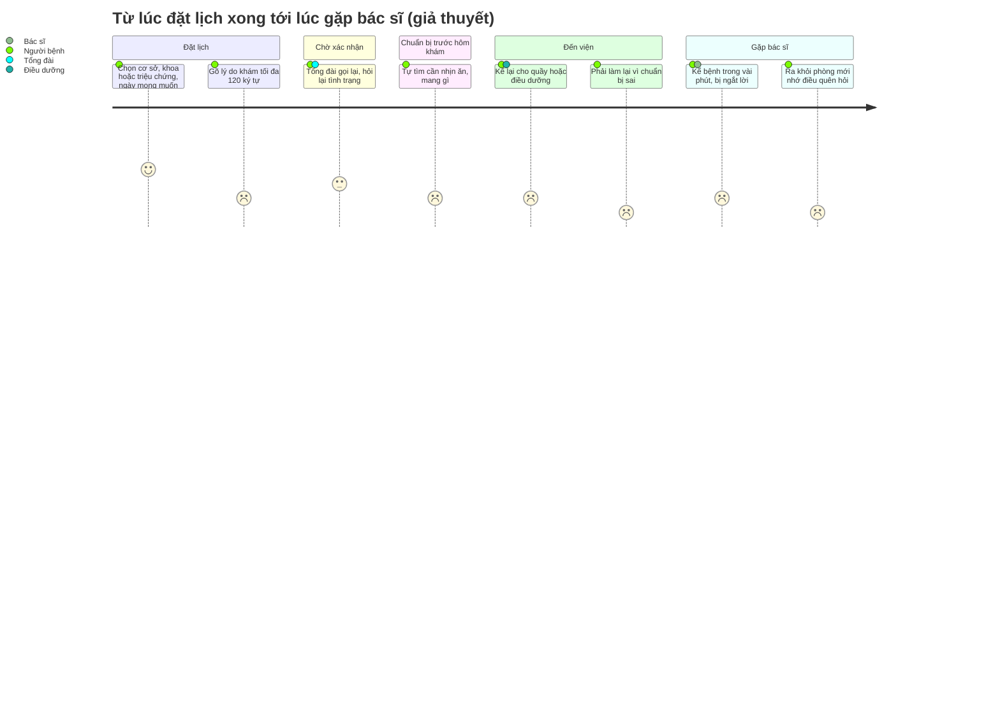

# Journey map: từ lúc đặt lịch xong tới lúc gặp bác sĩ

> **Trạng thái: BẢN GIẢ THUYẾT.** Bước 1–3 dựa trên dùng thử MyVinmec thật (2 video, 15/10/2026). Cảm xúc và điểm đau
> ở bước 4–7 là giả thuyết từ nghiên cứu, **chưa có phỏng vấn**.
> ⚠️ THÁI CẬP NHẬT sau phỏng vấn: gắn mã P vào từng điểm đau, xoá điểm đau không ai nhắc tới, thêm điểm đau mới.

Persona giả định: người đi làm 25–40 tuổi, đặt lịch cho chính mình hoặc đi khám cùng bố mẹ.

| Bước | Người bệnh làm gì | Suy nghĩ / cảm xúc | Điểm đau | Bằng chứng |
|---|---|---|---|---|
| 1. Đặt lịch | Chọn cơ sở → theo bác sĩ, khoa hoặc triệu chứng → **ngày mong muốn** (không chọn giờ) | 😀 | — | Video V1 1:20–1:31 |
| 2. Gõ lý do khám | Gõ vào ô ≤ 120 ký tự; nếu đã nói chuyện với MIA thì gõ lại | "Lại phải gõ nữa à" 😐 | ⚡ **Đ1. Kể đi kể lại**: form triệu chứng, MIA, ô lý do khám, rồi tổng đài, điều dưỡng, bác sĩ | Dùng thử: T3 (V2 1:07–1:47); phỏng vấn: P? |
| 3. Chờ xác nhận | Tổng đài gọi lại chốt giờ | Chưa biết hôm đó cần gì 😐 | — | Desk research form web; phỏng vấn: P? |
| 4. Chuẩn bị trước hôm khám | Tự tra "có cần nhịn ăn không", hỏi người quen | "Không biết có phải xét nghiệm máu không" 😟 | ⚡ **Đ2. Không biết cần chuẩn bị gì** cho đúng lịch hẹn của mình; hướng dẫn chỉ có dạng bài viết chung trên web | Trang Vinmec "Những lưu ý trước khi khám sức khỏe tổng quát"; app: chưa thấy; phỏng vấn: P? |
| 5. Đến viện | Kể lại lý do ở quầy hoặc với điều dưỡng; có thể phải chờ vì chưa nhịn ăn | 😤 nếu phải làm lại | ⚡ **Đ3. Chuẩn bị sai → chờ thêm hoặc hẹn lại** | P? |
| 6. Gặp bác sĩ | Kể trong vài phút | Hồi hộp, sợ làm mất thời gian bác sĩ 😟 | ⚡ **Đ4. Không nói hết điều lo, bị ngắt lời** | Nghiên cứu: chỉ 4/35 nói hết điều định nói; bác sĩ hỏi người bệnh muốn bàn gì ở 36% lượt khám, ngắt lời sau trung vị 11 giây. Phỏng vấn: P? |
| 7. Ra khỏi phòng | Nhớ ra điều quên hỏi | "Thôi để lần sau" 😞 | ⚡ **Đ5. Quên hỏi**, phải gọi lại hoặc tra mạng | P? |
| 6b. Đi cùng hoặc thay người thân | Kể giúp bố mẹ hoặc con | "Không phải mình nên không nắm hết" 😟 | ⚡ **Đ6. Người kể không phải người bệnh** | P? |
| (ẩn) Tình huống nguy hiểm | Người có dấu hiệu cấp cứu vẫn đặt lịch thường | Không nhận ra mức độ | ⚡ **Đ7. Trì hoãn cấp cứu** (an toàn, không phải tiện lợi) | Dùng thử: T1, T2 |

## Điểm đau ưu tiên

Ưu tiên điểm đau xuất hiện nhiều nhất trong phỏng vấn **và** nằm trong khả năng của prototype: Đ4 + Đ5 (nói hết và hỏi
đủ), Đ1 (kể một lần), Đ2 + Đ3 (chuẩn bị đúng). Đ7 bắt buộc xử lý vì an toàn. Đ6 dùng để kiểm tra thiết kế (đặt hộ).

Nguồn nghiên cứu: [00-huong-tinh-nang-moi.md](../00-huong-tinh-nang-moi.md), mục 3.
