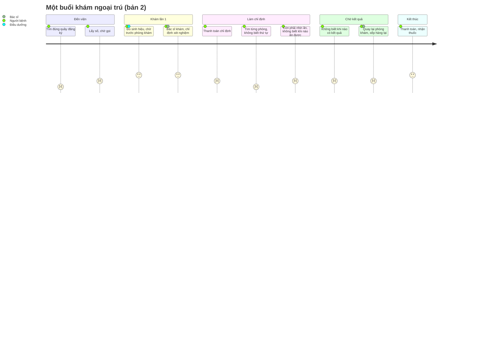

# Journey map (bản 2, 18/10/2026): một buổi khám ngoại trú, từ cửa viện tới lúc nhận thuốc

> Bản 1 (đoạn "đặt lịch xong → gặp bác sĩ", hướng H1) giữ ở [journey-map-v1.md](journey-map-v1.md).
> Bản 2 trước khi gắn bằng chứng: [journey-map-v2.md](journey-map-v2.md).
> **Trạng thái (18/10 tối):** cột "Bằng chứng" chỉ ghi nguồn có thật. **P1, P2** là hai buổi có bản ghi. Điểm đau nào chưa
> có trong bản ghi thì ghi rõ "chưa có bằng chứng phỏng vấn"; đó là giả thuyết từ desk research hoặc từ lời Thái nhớ lại.

Persona: người đến khám lần đầu, **không đặt lịch trước**, có thể đi cùng bố mẹ lớn tuổi.

| Bước | Người bệnh làm gì | Suy nghĩ / cảm xúc | Điểm đau | Bằng chứng |
|---|---|---|---|---|
| 1. Vào cửa viện | Đến sớm lấy số, quét thẻ BHYT, tự chọn khoa (P1) | 😐 | Đ1. Không biết quầy nào (**giả thuyết**) | **Chưa có bằng chứng phỏng vấn (0/2).** P1 mô tả ngược lại: "giờ nó quét bằng má, quét bằng máy hết rồi" [01:43]. Thái nhớ lại từ cuộc không ghi |
| 2. Đăng ký, điền phiếu | Điền thông tin cá nhân, nói tình trạng (P2) | 😐 | — | P2 [01:08]. Ý "phiếu là trắc nghiệm" không có trong bản ghi |
| 3. Chờ, gặp bác sĩ lần 1 | Đo sinh hiệu, chờ gọi số | Sốt ruột khi số "nhảy cóc" 😐 | ⚡ **Đ2. Không hiểu thứ tự gọi số** | VnReview (số cấp cho cả lộ trình) |
| 4. Thanh toán chỉ định | Ra thu ngân hoặc trả trên app | "Lại xếp hàng" 😐 | ⚡ Đ3. Thêm một lần xếp hàng (UMC Care, MyVinmec đã cho trả trên app) | UMC Care: thanh toán chỉ định trong app |
| 5. Đi làm xét nghiệm, chụp | Cầm phiếu đi chụp, siêu âm rồi mang kết quả về cho bác sĩ (P1); bị "đẩy qua phòng" (P2) | P2: rườm rà 😟 | Đ4. Không biết thứ tự, đi vòng (**giả thuyết**). Đ4b. **Không hiểu vì sao phải làm thêm, nghi bị bán thêm dịch vụ** (P2) | Đ4: chưa có bằng chứng phỏng vấn. Đ4b: P2 [01:56], [03:47], 1/2 |
| 5b. Đang nhịn ăn | Đói, không biết khi nào được ăn | 😟 | ⚡ Đ5. Không biết xong mục nhịn ăn chưa | Hướng dẫn Vinmec: không ăn sáng trước lấy máu |
| 6. Chờ kết quả | Ngồi chờ, hỏi nhân viên | "Bao giờ có?" 😐 | ⚡ **Đ6. Không biết khi nào có kết quả** | Khảo sát hài lòng ngoại trú: chờ ở khâu trả kết quả |
| 7. Quay lại bác sĩ | Mang kết quả về cho bác sĩ xem (P1) | 😐 | Đ7. Quay lại khi chưa đủ kết quả (**giả thuyết**) | P1 [02:56] chỉ mô tả bước này, không than |
| 8. Nhận thuốc, về | Thanh toán, lấy thuốc | 😀 nếu trả được trên app | — | UMC Care: kết toán BHYT trên app (6/2026) |
| (ẩn) Người đi cùng bố mẹ | Vừa dẫn đường vừa lo thủ tục | 😟 | Đ8. Một người phải lo hết (**giả thuyết**) | Chưa có bằng chứng phỏng vấn |
| 10. Tái khám | Quét lại thẻ, làm lại quy trình, tự nói đã có lịch sử khám (P1) | 😐 | Đ10. Kể lại lịch sử ở mỗi lần tái khám | P1 [03:08], không tỏ ra bực |
| (ẩn) Tình huống nguy hiểm | Người bệnh trở nặng khi đang chờ | Không biết báo ai | ⚡ **Đ9. Không biết khoa Cấp cứu ở đâu** (an toàn) | Luật cấp cứu giữ từ bản trước |

## Điểm đau ưu tiên

**Chưa chọn được điểm đau ưu tiên bằng bằng chứng.** Đ1, Đ4, Đ6 (hướng Lộ trình) hiện **chưa có trong bản ghi phỏng vấn**.
Tín hiệu có cảm xúc nhất trong bản ghi là **Đ4b** (rườm rà, nghi bị làm thêm dịch vụ; P2, 1/2). Đ9 bắt buộc xử lý vì an toàn.
Đ3 và bước 8 đã được các app lớn giải nên không làm lại.
