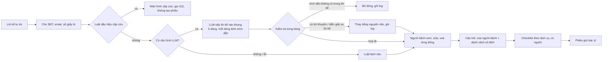

# Prototype: Chuẩn bị buổi khám

Web app chạy trên máy, giao diện điện thoại. Sau khi lịch hẹn được xác nhận (giả lập), người bệnh hoặc người thân dành
khoảng 2 phút:

1. **Kể** bằng lời thường: chuyện gì, từ khi nào, đã làm gì, lo gì, muốn bác sĩ giúp gì.
2. App sắp xếp lời kể vào **phiếu 5 dòng cho bác sĩ**. Mỗi dòng kèm câu người bệnh đã kể. Người bệnh sửa hoặc xoá từng
   dòng trước khi gửi.
3. Chọn **câu hỏi mang vào phòng khám**: câu người bệnh tự kể, cộng với câu gợi ý chung (không chọn sẵn), cộng với câu
   tự thêm. App **không trả lời** các câu này.
4. Xem **checklist chuẩn bị** theo loại lịch hẹn. Mỗi mục ghi nguồn: hướng dẫn công khai của Vinmec, hoặc đề xuất của
   prototype.
5. Gửi phiếu, xem phiếu **đúng như bác sĩ sẽ thấy**, rồi để lại phản hồi.

Nếu lời kể có dấu hiệu cấp cứu, app **dừng ngay** và hướng dẫn gọi 115.

Ảnh chụp các màn: `screenshots/1-lich-hen.png` … `7-cap-cuu.png`.

## Chạy

```bash
cd 05-prototype/app
python3 server.py                     # chế độ luật, không cần API key, không cài thêm gì
# hoặc chế độ LLM (API tương thích OpenAI: OpenAI, Groq, Gemini OpenAI-compatible...)
LLM_API_KEY=... LLM_MODEL=... LLM_BASE_URL=https://.../v1 python3 server.py
# mở http://localhost:8000 (đổi cổng: PORT=8791 python3 server.py; đổi file log: LOG_FILE=...)
```

Đánh giá: `python3 eval/run_eval_prep.py` (thêm `--llm` để đo chế độ LLM).

Module gợi ý chuyên khoa của hướng ban đầu vẫn chạy được ở `http://localhost:8000/chon-khoa.html`, đo bằng
`python3 eval/run_eval.py` (backlog B1, xem [../BACKLOG.md](../BACKLOG.md)).

## Thiết kế: workflow có một bước AI, không phải agent



| Quyết định | Lý do |
|---|---|
| Luật cấp cứu chạy **trước** AI, trên toàn bộ lời kể | Lỗi bỏ sót cấp cứu quá đắt; luật cố định kiểm thử được và phản hồi tức thì. Bài học từ MyVinmec: cảnh báo qua LLM mất khoảng 20 giây (T2) |
| AI chỉ làm **một** việc: xếp lời kể vào khung cố định | Day 2: chỉ một điểm cần hiểu ngôn ngữ, còn lại là rule |
| **Mỗi dòng phải có trích dẫn nguyên văn** từ lời kể | Chặn AI thêm điều người bệnh không nói; đo được (số dòng bị loại) |
| Người bệnh **duyệt từng dòng** trước khi gửi | Human-in-the-loop; số dòng bị sửa hoặc xoá là thước đo lỗi AI |
| Câu hỏi gợi ý và checklist là **luật cố định** | Không để LLM sinh nội dung y khoa; bác sĩ hoặc bệnh viện duyệt một lần |
| Câu hỏi y khoa của người bệnh **không được trả lời** | Đề cấm lời khuyên y khoa; câu hỏi chuyển cho bác sĩ |
| Không bắt buộc, có "Để sau", người thân điền hộ được | Nghiên cứu Epic: chỉ 26% người ≥ 65 tuổi điền phiếu trước khám |
| LLM lỗi → luật | Người dùng không bị chặn vì API timeout |
| Log ẩn danh từng sự kiện | Để viết test log có bằng chứng; SĐT/email bị che trước khi ghi |

Prompt hệ thống nằm trong `app/prep.py` (`SYSTEM_PROMPT`). Prompt cấm suy luận, chẩn đoán, khuyên thuốc và trả lời câu
hỏi; yêu cầu mỗi mục có `quote` nguyên văn; yêu cầu trả về JSON.

## Kết quả đánh giá (chế độ luật, 15/10/2026)

```
Chế độ: luật · 24 lời kể (14 thường, 10 cấp cứu)
Bắt được ca cấp cứu (mục tiêu 100%):              10/10
Báo cấp cứu nhầm ở ca thường:                      0/14
Mục phiếu kỳ vọng có mặt:                          37/37
Mục phiếu đúng nội dung (chứa cụm kỳ vọng):        37/37
Câu hỏi của người kể được giữ lại:                 5/5
Dòng không có căn cứ trong lời kể (mục tiêu 0):    0
Dòng có lời khuyên/chẩn đoán do máy thêm (mục tiêu 0): 0
Lộ SĐT trong kết quả (mục tiêu 0):                 0
```

Đọc con số này cho đúng:
- **Lạc quan, đừng trích như kết quả thật.** Bộ 24 lời kể và bộ luật do cùng một người (AI) viết. Lần chạy đầu được
  34/37 mục phiếu; 3 ca trượt ("cả tuần nay", "muốn đo lại…", "muốn chụp phim") được sửa bằng cách mở rộng luật cho
  mẫu câu chung, sau khi đã thấy ca trượt. Khi chạy thử thẻ K1 còn phát hiện thêm một lỗi: "Sợ bị nặng, có cần chụp
  phim không?" bị coi là hai câu hỏi; đã sửa để chỉ vế cuối mang dấu hỏi. Cần lời kể do người khác viết mới đo được thật.
- Ở chế độ luật, "không bịa" đúng theo cách dựng: luật chỉ cắt câu từ lời kể. Chỉ số này có ý nghĩa ở **chế độ LLM**.
- Guardrail của chế độ LLM đã được thử bằng một đầu ra giả lập cài sẵn lỗi: dòng có trích dẫn không có trong lời kể bị
  bỏ, dòng "Bạn bị … nên uống thuốc" bị thay bằng nguyên văn, mục ngoài khung bị bỏ, dòng diễn giải thêm "nặng dần, lan
  xuống chân" bị thay bằng nguyên văn. LLM lỗi (endpoint không tồn tại) thì tự chuyển sang luật (`llm-loi:URLError`).
- **Chưa đo chế độ LLM thật** vì chưa cấu hình API key. ⚠️ THÁI: chạy `run_eval_prep.py --llm` rồi dán kết quả vào đây.
- Phân loại của luật còn thô: một mệnh đề chỉ vào một mục; câu không nhận ra thì xếp vào "Lý do chính".

Kiểm thử giao diện (15/10/2026): Playwright + Chrome chạy 5 luồng, không có lỗi JavaScript hay hộp thoại:
(A) bản thân, đi hết luồng, tự thêm một mục và một câu hỏi, gửi, phản hồi; (B) người thân là trẻ em, khám tổng quát:
checklist bỏ mục dành cho người lớn, thêm sổ tiêm, có link nguồn Vinmec; (C) lời kể có dấu hiệu đột quỵ → màn cấp cứu
→ "Tôi kể nhầm" quay lại; (D) "Để sau"; (E) module chọn khoa cũ vẫn gợi ý đúng. Log của lượt test đã được tổng hợp bằng
`summarize_log.py` và khớp với thao tác.

## Thử với người dùng

- Kịch bản: [test-scenarios.md](test-scenarios.md). Người thử **đóng vai theo thẻ kịch bản**, không kể sức khoẻ thật.
- Log máy ghi tự động: `logs/sessions.jsonl` (đã che SĐT/email). Log do người điều phối viết: [test-log.md](test-log.md).

## Giới hạn đã biết

- Lịch hẹn, dịch vụ, checklist là **giả lập**; mục "đề xuất của prototype" cần bệnh viện xác nhận.
- Phủ định chỉ xét 2 từ đứng trước ("không khó thở"); câu phủ định phức tạp hơn có thể bị báo cấp cứu nhầm.
- Danh sách dấu hiệu cấp cứu là bản tham khảo phổ biến, **chưa được bác sĩ duyệt**.
- Kiểm tra "diễn giải xa lời kể" dựa trên tỷ lệ từ trùng (≥ 70%), nên vẫn có thể lọt câu đảo nghĩa dùng đúng từ của
  người bệnh. Vì vậy người bệnh vẫn phải duyệt từng dòng.
- Chưa có phía bác sĩ thật: màn "bác sĩ thấy phiếu này" chỉ là mô phỏng.
