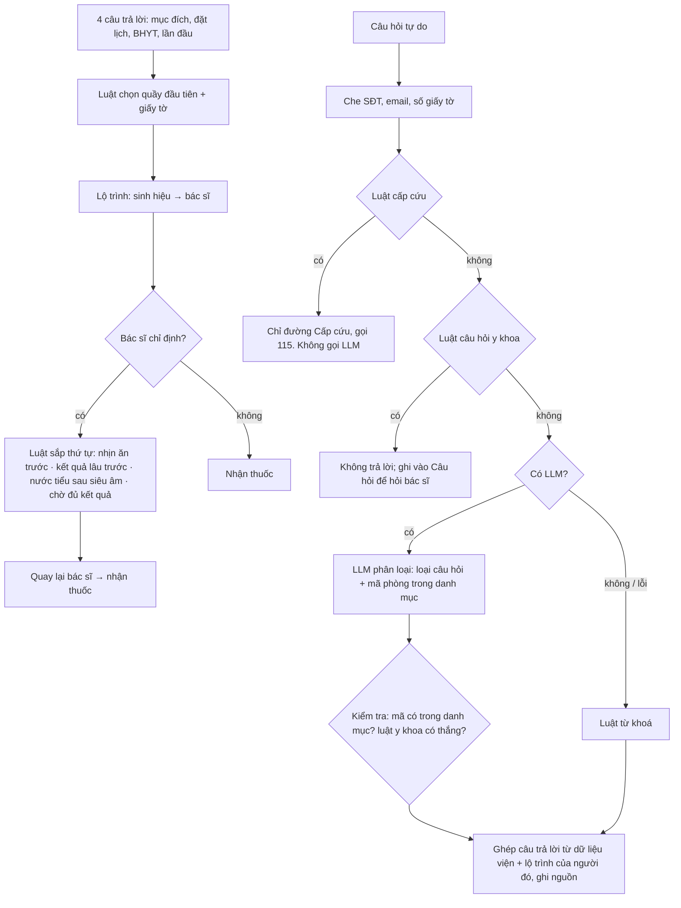

# Prototype (bản 3, 18/10/2026): Lộ trình khám trong ngày

> Các bản trước vẫn chạy được để đối chiếu, tài liệu giữ ở [README-v1.md](README-v1.md):
> `/index-v2.html` và `/index-v1.html` là "Chuẩn bị buổi khám" (hướng H1); `/chon-khoa.html` là gợi ý chuyên khoa
> (hướng H0). Vì sao đổi: [../VERSIONS.md](../VERSIONS.md).

**Tour cho hội đồng:** mở `http://localhost:8000/?tour=1` (hoặc nút "Tour cho người chấm" ở Trang chủ). Tour 17 bước tự
thao tác, đi cả luồng người đến thẳng và luồng người đã đặt lịch (`app/static/tour.js`). Ở màn rộng (từ 1080px), màn điện
thoại giữ đúng giao diện người dùng, hai bên là **nghiên cứu và bằng chứng** (trái) và **lý do thiết kế** (phải), có nút
Trước/Tiếp, phím ← →, và nút **"Thoát tour, tự dùng thử từ màn này"** ở mọi bước (app giữ nguyên màn đang xem; nút nổi
"Quay lại tour" đưa về đúng bước). Màn hẹp hơn thì ghi chú hiện trong khung điện thoại. Bản ghi sẵn: [GIF](screenshots/tour/tour-hoi-dong.gif),
[MP4](screenshots/tour/tour-hoi-dong.mp4), [ảnh từng bước](screenshots/tour/); bản ghi các phiên bản trước ở `screenshots/tour/v1/`,
`v2/`. Lượt tour ghi log với mã `TOUR` và `eval/summarize_log.py` bỏ qua mã này. Ảnh trong `screenshots/` (ngoài thư mục
`tour/`) là của prototype H1 cũ.

Web app chạy trên máy, giao diện mô phỏng MyVinmec (bản mô phỏng cho bài tập, không phải app thật). Người bệnh **đang ở
viện** mở "Lộ trình hôm nay":

1. Trả lời 4 câu: đến để làm gì, đã đặt lịch chưa, có BHYT không, lần đầu hay đã từng khám. App chỉ **đúng quầy đầu
   tiên** và giấy tờ cần mang (giả thuyết "không biết vào quầy nào", **chưa có trong bản ghi phỏng vấn**: 0/2).
2. Xem **bước tiếp theo** (phòng, tầng, khu, cách tìm, vì sao làm bước này) và toàn bộ lộ trình kèm giờ dự kiến.
3. Khi bác sĩ chỉ định (prototype có ô "mô phỏng chỉ định"), lộ trình **tự sắp lại**: mục nhịn ăn trước, mục có kết quả lâu
   trước, nước tiểu sau siêu âm ổ bụng, có bước chờ đủ kết quả rồi mới quay lại bác sĩ.
4. **Người đã đặt lịch** không phải trả lời lại 4 câu: mở **Lịch hẹn → "Xem lộ trình hôm khám"**. Lộ trình bắt đầu từ lúc
   đặt lịch: *Đã đặt lịch* → *Chuẩn bị trước ngày khám* (theo dịch vụ; khám tổng quát lấy từ hướng dẫn công khai của
   Vinmec) → *Check-in ở kiosk* trước giờ hẹn → … Giờ dự kiến tính theo giờ hẹn; khám tổng quát biết trước gói chỉ định nên
   các mục xét nghiệm, chụp chiếu được sắp sẵn từ lúc đặt. Màn đặt lịch chỉ là mô phỏng tối giản, vì app thật đã có.
5. Bấm **"Hỏi"** để hỏi bằng lời thường: phòng ở đâu, được ăn chưa, bao lâu có kết quả, thanh toán ở đâu. Câu hỏi y khoa
   không được trả lời mà được ghi vào **"Câu hỏi để hỏi bác sĩ"**. Có dấu hiệu cấp cứu thì chỉ đường khoa Cấp cứu và gọi 115.

Bệnh viện, phòng, vị trí, thời gian chờ đều **giả lập**. Hướng dẫn chuẩn bị có ghi nguồn: theo trang công khai của
Vinmec hoặc "giả lập, cần viện xác nhận".

## Bản deploy

<https://lo-trinh-kham-prototype.vercel.app> (Vercel, chế độ luật, không có API key). Cấu hình: `app/vercel.json` (file tĩnh
trong `static/`, `noindex`), `app/api/*.py` (mỗi endpoint một function, dùng lại `server.Handler`). Trên Vercel log chỉ ghi vào
`/tmp` và mất khi function khởi động lại: **log thử thật phải chạy local**. Deploy lại: `cd 05-prototype/app && vercel deploy --prod`.

## Chạy

```bash
cd 05-prototype/app
python3 server.py                     # chế độ luật, không cần API key, không cài thêm gì
LLM_API_KEY=... LLM_MODEL=... LLM_BASE_URL=https://.../v1 python3 server.py   # chế độ LLM (API tương thích OpenAI)
# mở http://localhost:8000 (đổi cổng: PORT=8010; đổi file log: LOG_FILE=...)
```

Đánh giá: `python3 eval/run_eval_lotrinh.py` (bộ chính), `--heldout` (bộ kiểm tra riêng), thêm `--llm` để đo chế độ LLM.
Tóm tắt log thử: `python3 eval/summarize_log.py`.

## Thiết kế: lộ trình là luật, AI chỉ ở một bước



| Quyết định | Lý do |
|---|---|
| Lộ trình do **luật** sắp, mỗi bước ghi "vì sao" | Thứ tự phòng là nghiệp vụ, kiểm thử được, không cần AI (Day 2). Người bệnh hiểu được lý do thì tin hơn |
| Luật cấp cứu chạy **trước**, có dấu hiệu thì **không gọi LLM** | Lỗi bỏ sót quá đắt; phản hồi tức thì. Bài học từ MIA của MyVinmec: cảnh báo qua LLM mất khoảng 20 giây |
| Luật câu hỏi y khoa **thắng** phân loại của LLM | LLM có thể xếp "kết quả máu có sao không" thành câu hỏi vị trí; luật kéo về "hỏi bác sĩ" |
| LLM **chỉ phân loại** vào danh mục cố định, **không viết câu trả lời** | Không thể bịa phòng, giờ hay hướng dẫn. Mã ngoài danh mục bị bỏ, dùng mã luật tìm được |
| Câu trả lời ghi **nguồn** (lộ trình, sơ đồ viện, hướng dẫn Vinmec) | Người bệnh và người chấm biết thông tin từ đâu |
| Câu hỏi y khoa được **ghi lại để hỏi bác sĩ** | Không bỏ rơi người hỏi; nối với nghiên cứu về danh sách câu hỏi (best practice AHRQ) |
| LLM lỗi → luật | Người dùng không bị chặn vì API timeout |
| Log ẩn danh từng sự kiện, kể cả câu hỏi đã che SĐT | Để viết test log có bằng chứng và chấm tay câu hỏi thật của người thử |

Prompt nằm trong `app/lotrinh.py` (`SYSTEM_PROMPT`): chỉ phân loại, không trả lời; danh mục loại câu hỏi và mã phòng được
chèn vào prompt; trả về JSON.

## Kết quả đánh giá (chế độ luật, 18/10/2026)

**Lộ trình:** 16/16 ràng buộc đúng (mục nhịn ăn trước; nước tiểu sau siêu âm; thanh toán trước khi làm chỉ định; chờ
đủ kết quả rồi mới quay lại bác sĩ; quầy đầu tiên đúng theo đặt lịch/BHYT; giờ dự kiến không đi lùi; có lịch hẹn thì bắt
đầu từ "Đã đặt lịch → Chuẩn bị → Check-in kiosk", check-in trước giờ hẹn, gặp bác sĩ không sớm hơn giờ hẹn; khám tổng
quát biết trước gói; lịch hẹn không hợp lệ bị bỏ qua).

**Trợ lý**, ba lần đo, giữ nguyên cả ba (file trong `eval/results/`):

| Lần | Bộ câu hỏi | Hiểu đúng loại | Đúng phòng | Cấp cứu | Câu y khoa bị chặn | Chặn nhầm | "Chưa hiểu" |
|---|---|---|---|---|---|---|---|
| 1 · luật ban đầu | Bộ chính 44 câu | 36/44 | 14/14 | 4/4 | **4/6** | 0/34 | 4/34 |
| 2 · bổ sung luật sau khi xem lần 1 | Bộ chính 44 câu | 44/44 | 14/14 | 4/4 | 6/6 | 0/34 | 0/34 |
| 3 · **held-out**, viết sau khi chỉnh luật | 20 câu mới | **14/20** | 5/6 | 2/2 | **1/3** | 0/15 | 3/15 |
| 4 · bộ held-out2 do Cursor viết, chạy **trước** khi vá luật y khoa (19/10) | 20 câu, cố ý nhiều câu y khoa nói vòng | 14/20 | — | 2/2 | **0/6** | 0/12 | — |
| 5 · sau khi vá (19/10): bộ chính · held-out · held-out2 | (luật viết sau khi thấy các câu trượt) | 44/44 · 16/20 · 20/20 | — | 4/4 · 2/2 · 2/2 | 6/6 · 3/3 · 6/6 | 0 · 0 · 0 | — |

Đọc cho đúng:
- **Vá luật y khoa 19/10** (Cursor làm, Tatejo chạy lại để nghiệm thu): câu diễn giải kết quả, thuốc, thực phẩm chức năng không bao giờ nhận
  câu trả lời vị trí phòng; khi không chắc thì bảo hỏi bác sĩ hoặc nhân viên. Số **khách quan** duy nhất của lần vá là held-out2
  **trước khi vá: 0/6** (luật cũ yếu). Các số sau khi vá (lần 5) đều trên câu đã thấy khi viết luật nên **không khách quan**;
  số khách quan sau khi vá **chưa có**. 12 câu thường ngày thử thêm (nhà thuốc ở đâu, phim x quang lấy ở đâu…) không bị chặn nhầm.
- **Con số 44/44 không có ý nghĩa**: luật đã được chỉnh theo chính bộ đó. Con số đáng tin là **held-out 14/20**.
  Lần chạy held-out đầu tiên được 13/20 và lộ ra một lỗi thật: sau khi bỏ dấu, "chuẩn **bị gì không**" trùng với cụm y khoa
  "**bị gì không**" nên câu hỏi chuẩn bị điện tim bị chặn nhầm. Mình đã sửa riêng lỗi đó (và cách chấm "cùng một phòng"),
  không thêm luật nào theo held-out.
- **Luật từ khoá bỏ sót câu y khoa nói vòng** ("x quang thấy phổi mờ là bị gì", "có nên uống thêm vitamin không"). Khi bỏ
  sót, câu trả lời **vẫn không chứa lời khuyên y khoa** vì mọi câu trả lời đều ghép từ dữ liệu phòng; người hỏi nhận "chưa
  hiểu" hoặc một vị trí. An toàn giữ được nhờ cách dựng, nhưng trải nghiệm kém. Đây là chỗ cần LLM chứng minh giá trị.
- Bộ câu hỏi do AI viết (cùng tác giả với luật). Bộ câu hỏi thật là câu người thử gõ, in ra bằng `summarize_log.py`.
- **Chưa đo chế độ LLM thật** (chưa có API key). ⚠️ THÁI: chạy `run_eval_lotrinh.py --heldout --llm` rồi dán kết quả
  vào bảng trên. Nếu LLM không vượt rõ 14/20 và 1/3 thì nên bỏ AI, giữ luật (ghi rõ trong need statement).

**Guardrail chế độ LLM** đã thử bằng LLM giả cài sẵn lỗi (18/10): mã phòng bịa → bị bỏ, dùng mã luật tìm được, trả đúng
phòng siêu âm; LLM xếp "kết quả máu có sao không" thành câu hỏi vị trí → luật y khoa thắng; intent ngoài danh mục → "chưa
hiểu"; câu có dấu hiệu cấp cứu → LLM **không được gọi**; LLM timeout → chuyển sang luật (`llm-loi:TimeoutError`).

**Giao diện** (Playwright + Chrome, 18/10): đi hết luồng người có BHYT, chưa đặt lịch → nhập 4 chỉ định → lộ trình sắp lại
đúng thứ tự → hỏi 4 câu (nhịn ăn, vị trí, y khoa, cấp cứu) → câu y khoa xuất hiện trong "Câu hỏi để hỏi bác sĩ" → xong
12 bước → phản hồi. Không lỗi JavaScript; 20 sự kiện log khớp thao tác. Module cũ: `run_eval_prep.py` và `run_eval.py`
cho kết quả như trước.

## Thử với người dùng

- Kịch bản: [test-scenarios.md](test-scenarios.md) (bản 1 của H1: [test-scenarios-v1.md](test-scenarios-v1.md)).
- Log máy: `logs/sessions.jsonl`. Log do người điều phối viết: [test-log.md](test-log.md).

## Giới hạn đã biết

- Sơ đồ phòng, thời gian chờ, thời gian có kết quả là **giả lập**; không phản ánh Vinmec hay bệnh viện nào.
- Giờ dự kiến chỉ cộng dồn thời gian giả lập, không theo hàng đợi thật; thực tế cần dữ liệu hệ thống gọi số (HIS/LIS).
- Lộ trình chưa xử lý: nhiều chuyên khoa trong một buổi, chỉ định cần hẹn riêng (nội soi), người ưu tiên.
- Chỉ định do người thử tự bấm (mô phỏng); app thật sẽ lấy từ hệ thống bệnh viện.
- Luật y khoa còn bỏ sót câu nói vòng (xem held-out); danh sách dấu hiệu cấp cứu chưa được bác sĩ duyệt.
