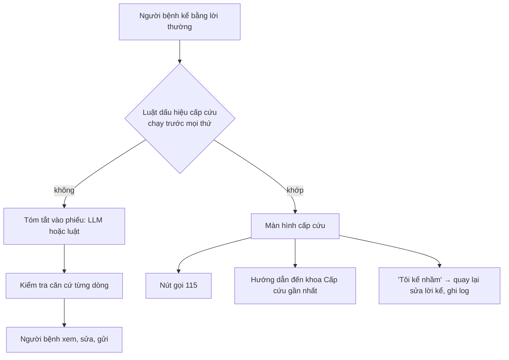

# Rủi ro an toàn, đạo đức và cách giảm thiểu

> **Bản 1 (15/10/2026), cho hướng H1; đã thay bằng [bản 2](rui-ro-dao-duc.md) ngày 18/10/2026.**

Áp cho tính năng **Chuẩn bị buổi khám** (H1). Thang đo theo Day 5: Khả năng xảy ra (L) × Mức tác động (I), mỗi trục 1–3.
Điểm ≥ 6 là phải xử lý trước khi cho người thật dùng.

## Risk register

| # | Rủi ro | Nhóm | L | I | Điểm | Giảm thiểu (đã làm ✅ / cần làm ⏳) | Owner |
|---|---|---|---|---|---|---|---|
| R1 | **Bỏ sót ca cấp cứu**: người bệnh kể dấu hiệu nguy hiểm trong lời kể dài rồi chờ tới ngày hẹn | An toàn | 2 | 3 | **6** | ✅ luật cấp cứu chạy trước AI trên toàn bộ lời kể, có dấu hiệu thì dừng và hiện nút gọi 115; ✅ đo 10/10 trên lời kể dài có dấu hiệu nằm giữa câu; ⏳ bác sĩ duyệt danh sách dấu hiệu | Thái → bác sĩ đầu mối |
| R2 | **AI thêm hoặc sai thông tin trong phiếu** (bác sĩ đọc phiếu sai) | An toàn | 2 | 3 | **6** | ✅ mỗi dòng phải kèm trích dẫn nguyên văn có trong lời kể, không có thì bỏ; ✅ dòng có dưới 70% số từ trong lời kể thì thay bằng nguyên văn; ✅ người bệnh xem và sửa từng dòng trước khi gửi, có link xem nguyên văn; ✅ log số dòng bị sửa hoặc xoá để đo lỗi AI; ⏳ bác sĩ xác nhận phiếu có giúp, không gây hiểu lầm | Thái → bác sĩ |
| R3 | **AI trả lời câu hỏi y khoa** của người bệnh (thành lời khuyên) | An toàn, pháp lý | 2 | 3 | **6** | ✅ prompt cấm; ✅ câu hỏi chỉ được ghi vào danh sách "hỏi bác sĩ"; ✅ câu hỏi gợi ý là danh sách cố định, chung chung, không do LLM sinh; ✅ dòng có "bạn bị", "nên uống"… bị thay | Thái |
| R4 | **Hướng dẫn chuẩn bị sai** (ví dụ nhịn ăn không cần thiết hoặc thiếu) | An toàn | 2 | 2 | 4 | ✅ checklist là luật cố định, mỗi mục ghi nguồn: "theo hướng dẫn công khai của Vinmec" (có link) hoặc "đề xuất của prototype, cần bệnh viện xác nhận"; ⏳ bộ phận chuyên môn duyệt checklist theo từng dịch vụ | Vinmec |
| R5 | **Lộ thông tin sức khoẻ** trong phiếu | Dữ liệu, privacy | 2 | 3 | **6** | ✅ nhắc không nhập tên, SĐT; ✅ che SĐT, email, số giấy tờ trước khi log hoặc gửi LLM; ✅ log không có định danh; ⏳ quy định ai được đọc phiếu (chỉ bác sĩ khám?) và lưu bao lâu; ⏳ production: LLM trong hạ tầng hoặc hợp đồng của bệnh viện | Vinmec IT |
| R6 | **Bất bình đẳng**: người lớn tuổi, người bệnh nặng không điền (nghiên cứu Epic: chỉ 26% người ≥ 65 tuổi điền) | Đạo đức | 3 | 2 | **6** | ✅ không bắt buộc, có nút "Để sau"; ✅ người thân điền hộ được; ✅ hiểu cả gõ không dấu; ✅ tổng đài và bác sĩ vẫn hỏi như cũ, phiếu chỉ là phần thêm; ⏳ phỏng vấn ít nhất 1 người lớn tuổi | Thái |
| R7 | **Bác sĩ dựa vào phiếu mà bỏ hỏi trực tiếp** (automation bias phía bác sĩ) | Đạo đức | 2 | 2 | 4 | ✅ phiếu ghi rõ "người bệnh tự kể, đã xem lại", không phải bệnh sử; ⏳ đào tạo: phiếu là điểm bắt đầu cuộc trò chuyện | Vinmec |
| R8 | **Gánh nặng đọc cho bác sĩ** (phiếu dài, nhiều câu hỏi) | Vận hành | 2 | 2 | 4 | ✅ khung 5 dòng cố định, mỗi dòng ≤ 3 ý; ✅ câu hỏi gợi ý mặc định không chọn; ⏳ đo thời gian đọc với bác sĩ | Thái |
| R9 | **Báo cấp cứu nhầm** gây hoảng | Trải nghiệm | 2 | 2 | 4 | ✅ chấp nhận có chủ đích (thà nhầm còn hơn sót); ✅ nút "Tôi kể nhầm, sửa lại" | Thái |
| R10 | **Nhầm prototype với app thật của bệnh viện** | Đạo đức | 1 | 2 | 2 | ✅ banner "prototype, dữ liệu giả lập"; không dùng logo | Thái |

## Đường chuyển tuyến khẩn cấp

Nguyên tắc:
1. **Không có nhánh nào từ màn hình cấp cứu đi tiếp sang tạo phiếu.** Người bệnh chỉ quay lại được bằng cách sửa lời kể.
2. Dấu hiệu cấp cứu được kiểm bằng **luật cố định**, không phụ thuộc prompt hay model. Đây cũng là bài học từ việc
   dùng thử MyVinmec: cảnh báo đi qua LLM ở trợ lý MIA mất khoảng 20 giây (T2).
3. Mọi lần hiện màn hình cấp cứu đều ghi log để rà soát báo nhầm hoặc bỏ sót.
4. Production: danh sách dấu hiệu phải do khoa Cấp cứu duyệt; phiếu có dấu hiệu nguy hiểm nên báo cho tổng đài gọi lại.

## Đạo đức khi làm bài tập (quy trình của chính mình)

- Phỏng vấn: xin đồng ý trước; chỉ hỏi về trải nghiệm chuẩn bị và gặp bác sĩ, không hỏi bệnh; ẩn danh P1–P3; không ghi
  âm khi chưa được đồng ý; không chụp ảnh người hay giấy tờ y tế; không đưa lời khuyên y khoa.
- Thử prototype: người thử đóng vai theo thẻ kịch bản, không nhập sức khoẻ thật.
- Dùng thử app: ảnh đưa vào repo đã cắt bỏ họ tên, SĐT, thông báo tin nhắn.
- Minh bạch AI: README ghi rõ phần nào do AI tạo.

## Điều kiện go/no-go trước khi cho bệnh nhân thật dùng

- [ ] Bác sĩ duyệt danh sách dấu hiệu cấp cứu và checklist chuẩn bị theo dịch vụ
- [ ] Recall cấp cứu = 100% trên bộ lời kể do bác sĩ viết (không phải bộ của mình)
- [ ] Không có dòng phiếu nào thiếu căn cứ hoặc có lời khuyên lọt qua sau ≥ 200 lượt thử
- [ ] Bác sĩ xác nhận phiếu giúp hiểu nhanh hơn và không làm hiểu lầm
- [ ] Có quy định ai đọc phiếu, lưu bao lâu; LLM chạy trong hạ tầng hoặc hợp đồng được bệnh viện duyệt
