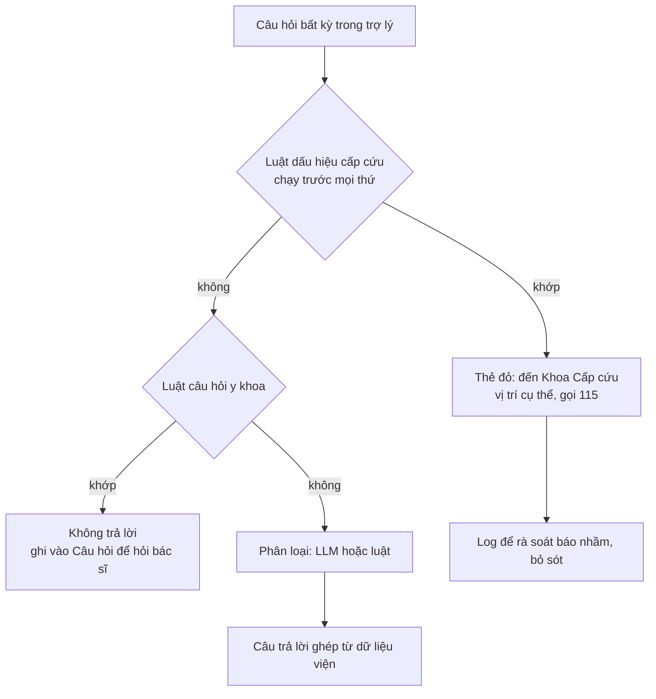

# Rủi ro an toàn, đạo đức và cách giảm thiểu (bản 2, 18/10/2026)

> Bản 1 (cho hướng "Chuẩn bị buổi khám") giữ ở [rui-ro-dao-duc-v1.md](rui-ro-dao-duc-v1.md).

Áp cho tính năng **Lộ trình khám trong ngày**. Thang đo theo Day 5: Khả năng xảy ra (L) × Mức tác động (I), mỗi trục 1–3.
Điểm ≥ 6 phải xử lý trước khi cho người thật dùng.

## Risk register

| # | Rủi ro | Nhóm | L | I | Điểm | Giảm thiểu (đã làm ✅ / cần làm ⏳) | Owner |
|---|---|---|---|---|---|---|---|
| R1 | **Người bệnh trở nặng khi đang chờ** mà app vẫn chỉ đường như thường | An toàn | 2 | 3 | **6** | ✅ luật cấp cứu chạy trước mọi thứ trên mọi câu hỏi, có dấu hiệu thì chỉ đường khoa Cấp cứu, nút gọi 115, **không gọi LLM**; ✅ đo 6/6 câu cấp cứu (bộ chính + held-out); ⏳ bác sĩ duyệt danh sách dấu hiệu; ⏳ nút "báo nhân viên" gửi vị trí cho điều dưỡng | Thái → bác sĩ đầu mối |
| R2 | **Trợ lý trả lời câu hỏi y khoa** (diễn giải kết quả, thuốc, chế độ ăn sau chẩn đoán) | An toàn, pháp lý | 2 | 3 | **6** | ✅ LLM **không viết câu trả lời**, chỉ phân loại; mọi câu trả lời ghép từ dữ liệu phòng và lộ trình, nên không thể chứa nội dung y khoa; ✅ luật y khoa thắng phân loại của LLM; ✅ câu y khoa được ghi vào "Câu hỏi để hỏi bác sĩ"; ⚠️ luật bỏ sót câu nói vòng (held-out 1/3), khi đó người hỏi nhận "chưa hiểu", không nhận lời khuyên; ⏳ đo chế độ LLM | Thái |
| R3 | **Chỉ sai đường, sai quầy** (dữ liệu phòng cũ, viện đổi bố trí) | Vận hành | 2 | 2 | 4 | ✅ mỗi câu trả lời ghi nguồn; ✅ luôn có lối thoát "hỏi Quầy thông tin tầng 1"; ⏳ production: dữ liệu phòng lấy từ hệ thống viện, có người chịu trách nhiệm cập nhật | Vinmec vận hành |
| R4 | **Thời gian dự kiến sai** làm người bệnh bỏ đi ăn hoặc về sớm, lỡ lượt | Vận hành | 3 | 2 | **6** | ✅ ghi rõ "ước tính giả lập" trên màn hình; ✅ không ước tính khi chưa có chỉ định; ⏳ production: lấy từ hệ thống gọi số (HIS/LIS), hiện khoảng thay vì một giờ; ⏳ hỏi người thử có tin giờ dự kiến không | Thái → Vinmec IT |
| R5 | **Hướng dẫn chuẩn bị sai** (nhịn ăn không cần, hoặc thiếu) | An toàn | 2 | 2 | 4 | ✅ chuẩn bị là dữ liệu cố định theo từng chỉ định, ghi nguồn Vinmec hoặc "giả lập, cần viện xác nhận"; ✅ hỏi nhịn ăn kèm bệnh nền (tiểu đường, thuốc huyết áp) bị chuyển cho nhân viên y tế, không tự trả lời | Vinmec chuyên môn |
| R6 | **Lộ thông tin**: câu hỏi chứa SĐT, tên; chỉ định của người bệnh | Dữ liệu, privacy | 2 | 3 | **6** | ✅ che SĐT, email, số giấy tờ trước khi log hoặc gửi LLM; ✅ prototype không lưu tên; chỉ định là mô phỏng; ⏳ production: chỉ định lấy qua tài khoản đã đăng nhập, LLM trong hạ tầng hoặc hợp đồng của viện, không gửi chỉ định cho LLM (LLM chỉ cần câu hỏi) | Vinmec IT |
| R7 | **Bất bình đẳng**: người lớn tuổi, người không dùng smartphone bị bỏ lại | Đạo đức | 3 | 2 | **6** | ✅ 4 câu hỏi đầu dạng bấm chọn, không cần gõ; ✅ trợ lý hiểu cả gõ không dấu; ✅ không thay biển báo và nhân viên; ⏳ người đi cùng mở hộ trên máy mình; ⏳ phiên bản kiosk ở sảnh, in lộ trình ra giấy | Thái |
| R8 | **Người bệnh tin app hơn nhân viên** khi hai bên nói khác nhau | Đạo đức | 2 | 2 | 4 | ✅ câu trả lời ghi nguồn và "giả lập"; ⏳ quy tắc: nhân viên tại chỗ luôn thắng; nhân viên có màn hình xem cùng lộ trình | Vinmec |
| R9 | **AI bị dùng làm chỉ số cho có**: luật đủ mà vẫn gắn AI | Sản phẩm | 2 | 1 | 2 | ✅ đo luật so với LLM trên held-out; ✅ cam kết trong need statement: LLM không vượt rõ thì bỏ AI | Thái |
| R10 | **Nhầm prototype với app thật** của bệnh viện | Đạo đức | 1 | 2 | 2 | ✅ nhãn "Bản mô phỏng cho bài tập · không phải app thật" ở Trang chủ; ✅ ghi chú giả lập ở màn đầu; không dùng logo bệnh viện | Thái |

## Đường chuyển tuyến khẩn cấp

Nguyên tắc:
1. Dấu hiệu cấp cứu được kiểm bằng **luật cố định**, không phụ thuộc prompt hay model, và LLM **không được gọi** khi có dấu
   hiệu. Bài học từ MIA của MyVinmec: cảnh báo đi qua LLM mất khoảng 20 giây.
2. Ở trong viện, đường đúng là **khoa Cấp cứu hoặc nhân viên gần nhất**; 115 dành cho người đang ở ngoài.
3. Production: khoa Cấp cứu duyệt danh sách dấu hiệu; thêm nút báo nhân viên kèm vị trí.

## Đạo đức khi làm bài tập (quy trình của chính mình)

- Phỏng vấn: xin đồng ý trước; chỉ hỏi về trải nghiệm đi khám, không hỏi bệnh; ẩn danh P1…; không ghi âm khi chưa đồng
  ý; không chụp ảnh người hay giấy tờ y tế; không đưa lời khuyên y khoa.
- Thử prototype: người thử đóng vai theo thẻ kịch bản, không nhập sức khoẻ thật.
- Dùng thử app: ảnh và video gốc của MyVinmec, UMC Care có thông tin cá nhân, **không** đưa vào repo.
- Minh bạch AI: README ghi rõ phần nào do AI tạo.

## Điều kiện go/no-go trước khi cho người bệnh thật dùng

- [ ] Dữ liệu phòng, chỉ định, thời gian chờ lấy từ hệ thống của viện, có người chịu trách nhiệm cập nhật
- [ ] Bác sĩ duyệt danh sách dấu hiệu cấp cứu và dữ liệu chuẩn bị theo từng chỉ định
- [ ] Recall cấp cứu = 100% và 0 câu trả lời có nội dung y khoa trên bộ câu hỏi do nhân viên viện viết
- [ ] Đo trên người dùng thật ở **Vinmec**: điểm đau có tồn tại ở viện tư không, số lần phải hỏi nhân viên có giảm không
- [ ] Có kênh cho người không dùng smartphone (kiosk, in giấy, nhân viên)
