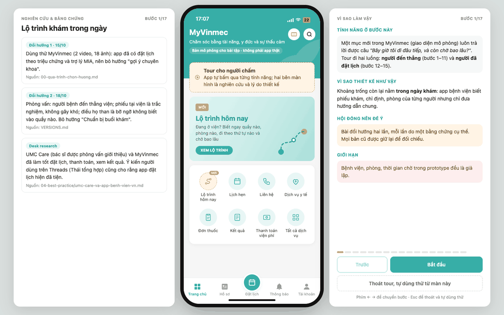

# Một lần đi khám: "Bây giờ tôi đi đâu tiếp, và còn chờ bao lâu?"

Bài tập 1 tuần, Exploration Sprint Vinmec × AI Thực Chiến · Thái Hoài An · K3

## Xem nhanh cho hội đồng (3–5 phút)



- **Không chạy code:** GIF ở trên (17 bước, mỗi bước 7 giây), video [tour-hoi-dong.mp4](05-prototype/screenshots/tour/v3/tour-hoi-dong.mp4)
  (56 giây), hoặc ảnh từng bước trong [05-prototype/screenshots/tour/](05-prototype/screenshots/tour/).
  Giữa màn là **giao diện đúng như người dùng thấy**; bên trái là **nghiên cứu và bằng chứng** của bước đó (kèm nguồn trong
  repo); bên phải là **tính năng, vì sao thiết kế như vậy, hội đồng nên để ý gì, giới hạn**.
- **Chạy thử:** `cd 05-prototype/app && python3 server.py`, mở `http://localhost:8000/?tour=1` trên màn hình rộng
  (từ 1080px). Phím ← → để chuyển bước, chấm tiến trình để nhảy tới bước bất kỳ. Nút **"Thoát tour, tự dùng thử từ màn này"** (hoặc
  Esc) có ở mọi bước: app giữ nguyên màn đang xem để tự bấm tiếp; nút nổi **"Quay lại tour"** ở góc trái đưa về đúng bước. Không cần cài gì thêm,
  không cần API key.
- **Đọc theo thứ tự:** câu chuyện đổi hướng ([VERSIONS.md](VERSIONS.md), [00-qua-trinh-chon-huong.md](00-qua-trinh-chon-huong.md))
  → [need statement](03-need-statement/need-statement.md) → [prototype và số đo](05-prototype/README.md)
  → [rủi ro](06-rui-ro-dao-duc/rui-ro-dao-duc.md).


**Khoảnh khắc đã chọn:** *Chờ*, hiểu rộng là **cả ngày khám tại viện**, từ cửa viện tới lúc nhận thuốc. Lý do chọn và lý
do loại các khoảnh khắc khác: [00-chon-khoanh-khac.md](00-chon-khoanh-khac.md).

**Need statement:** Cách để người bệnh khám ngoại trú, và người thân đi cùng, nhất là người đến lần đầu hoặc đến thẳng
không đặt lịch, gặp tình huống không biết bước tiếp theo phải đến quầy hay phòng nào, theo thứ tự nào và phải chờ tới
khi nào, có thể đi hết các bước của buổi khám đúng chỗ, đúng thứ tự, biết trước thời gian chờ, mà không phải hỏi nhiều
người hay quay lại chỗ cũ. ([chi tiết](03-need-statement/need-statement.md))

**Bài đã đổi hướng hai lần, đều theo bằng chứng:**
1. *15/10, sau khi dùng thử MyVinmec:* gợi ý chuyên khoa → "Chuẩn bị buổi khám", vì app đã có đặt lịch theo triệu chứng.
2. *18/10, sau khi phỏng vấn:* "Chuẩn bị buổi khám" → "Lộ trình khám trong ngày", vì người bệnh đến thẳng viện, phiếu tại
   viện không gây khó, còn điều họ than phiền là bỡ ngỡ không biết vào quầy nào; đặt lịch và thanh toán thì các app lớn
   (UMC Care, MyVinmec) đã làm tốt.

Quá trình: [00-qua-trinh-chon-huong.md](00-qua-trinh-chon-huong.md). Mọi bản cũ được giữ lại với hậu tố `-v1`, `-v2`,
danh sách ở [VERSIONS.md](VERSIONS.md). Các hướng chưa làm: [BACKLOG.md](BACKLOG.md).

## Mục lục

| Thư mục | Nội dung |
|---|---|
| [00-chon-khoanh-khac.md](00-chon-khoanh-khac.md) | Khoảnh khắc đã chọn (bản 2), vì sao đổi, so sánh theo tiêu chí A–F |
| [00-qua-trinh-chon-huong.md](00-qua-trinh-chon-huong.md) | Dòng thời gian 14–18/10, hai lần đổi hướng, bài học |
| [00-huong-tinh-nang-moi.md](00-huong-tinh-nang-moi.md) | Luồng 9 bước đi khám, đánh giá 7 hướng tính năng |
| [BACKLOG.md](BACKLOG.md) | Các hướng để phát triển lần sau, kèm điều kiện mở lại |
| [VERSIONS.md](VERSIONS.md) | Lịch sử phiên bản: tài liệu nào đã đổi, vì sao; bản cũ giữ lại với hậu tố `-v1` |
| [01-phong-van/](01-phong-van/) | Dùng thử MyVinmec (ghi chép, [gap analysis](01-phong-van/myvinmec-gap-analysis.md), ảnh đã che thông tin cá nhân), interview guide, log phỏng vấn P1–P3, tổng hợp insight |
| [02-journey-map/](02-journey-map/journey-map.md) | Journey map một buổi khám ngoại trú, đánh dấu điểm đau |
| [03-need-statement/](03-need-statement/need-statement.md) | Need statement (Biodesign) + problem statement 9 yếu tố + phần AI nói thật + go/no-go |
| [04-best-practice/](04-best-practice/best-practice.md) | Ubie AI 問診, AHRQ QuestionBuilder, Epic MyChart; so sánh 12 app đặt lịch; [UMC Care và app bệnh viện Việt Nam](04-best-practice/umc-care-va-app-benh-vien-vn.md) |
| [05-prototype/](05-prototype/README.md) | Web app "Lộ trình hôm nay" (giao diện mô phỏng MyVinmec), prompt, bộ câu hỏi + held-out + script đo, kịch bản thử, log thử. Các prototype cũ vẫn chạy |
| [06-rui-ro-dao-duc/](06-rui-ro-dao-duc/rui-ro-dao-duc.md) | Risk register, đường chuyển tuyến khẩn cấp, điều kiện go/no-go |
| [07-coach-plan/](07-coach-plan/coach-plan.md) | Mình sẽ coach một nhóm K4 làm bài này thế nào |
| [slides.pdf](slides.pdf) | 10 slide để present (nguồn: `slides/slides.html`, xuất bằng `slides/build.sh`) |

## Chạy prototype trong 1 phút

```bash
cd 05-prototype/app && python3 server.py      # mở http://localhost:8000, không cần cài gì thêm
python3 ../eval/run_eval_lotrinh.py --heldout  # đo trợ lý trên 20 câu chưa dùng để chỉnh luật
```

## Phần nào do AI tạo

Mình dùng Claude (Anthropic) làm trợ lý trong bài này. Phân chia cụ thể:

| Phần | AI làm | Mình làm |
|---|---|---|
| 00 Chọn khoảnh khắc, chọn hướng | Soạn bảng so sánh, desk research 12 app, đánh giá 7 hướng, ghi chép UMC Care từ video, báo cáo quá trình | Chọn khoảnh khắc; quay video dùng thử MyVinmec và UMC Care; phỏng vấn; đọc ý kiến trên Threads; bác bỏ H1; chốt hướng lộ trình |
| 01 Phỏng vấn | Soạn nháp interview guide và các mẫu ghi chép | Dùng thử MyVinmec, **phỏng vấn thật, viết log, tổng hợp insight** |
| 02 Journey map | Bản 1 (giả thuyết) và bản 2 viết theo lời Thái kể lại từ phỏng vấn và desk research | Gắn mã P vào từng điểm đau, sửa theo log phỏng vấn |
| 03 Need statement | Bản 1 (giả thuyết) và bản 2 viết theo lời Thái kể lại từ phỏng vấn | Duyệt câu chữ, điền số liệu phỏng vấn |
| 04 Best practice | Tìm nguồn, tóm tắt, đối chiếu số liệu với tóm tắt gốc trên PubMed/Europe PMC | Kiểm tra lại nguồn, rút bài học |
| 05 Prototype | Viết code, prompt, bộ câu hỏi giả lập và kỳ vọng (chưa được người dùng hay nhân viên viện duyệt), dữ liệu phòng giả lập | Chọn hướng, quyết định thiết kế, **thử với người thật, ghi log, sửa** |
| 06, 07 | Soạn nháp | Duyệt, chỉnh theo kinh nghiệm Lab Coach |
| Slides | Dựng khung | Điền kết quả thật |

Mọi trích dẫn, số liệu phỏng vấn và log thử nghiệm đến từ buổi làm việc thật với người tham gia, không do AI tạo.

## Ràng buộc đã tuân thủ

Xin đồng ý trước phỏng vấn · chỉ hỏi về trải nghiệm dịch vụ, không hỏi bệnh · ẩn danh P1, P2, P3 · không ghi âm khi
chưa được đồng ý · không chụp ảnh người hay giấy tờ y tế · không đưa lời khuyên y khoa · không dùng dữ liệu người bệnh
thật (prototype dùng dữ liệu giả lập; người thử đóng vai theo thẻ kịch bản).
