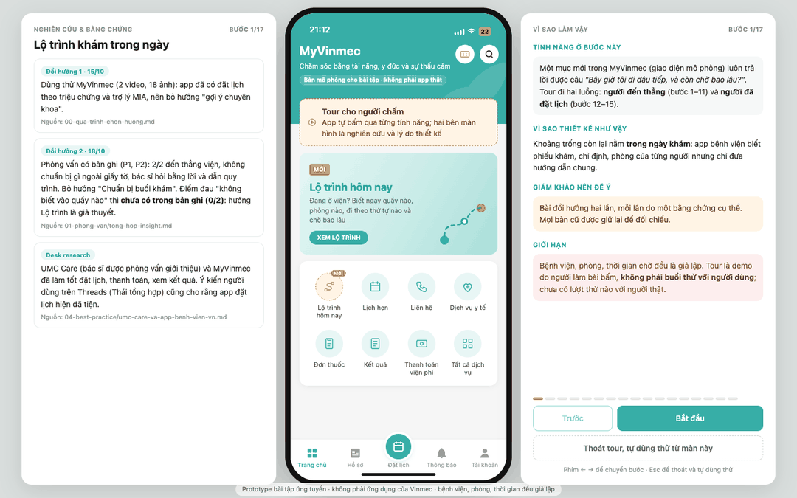

# Một lần đi khám: "Bây giờ tôi đi đâu tiếp, và còn chờ bao lâu?"

Bài tập 1 tuần, Exploration Sprint Vinmec × AI Thực Chiến · Thái Hoài An · K3

## Xem nhanh cho giám khảo (3–5 phút)

**Demo trực tuyến:** <https://lo-trinh-kham-prototype.vercel.app> · tour cho giám khảo: <https://lo-trinh-kham-prototype.vercel.app/?tour=1>
(bản mô phỏng cho bài tập, **không phải ứng dụng của Vinmec**; phòng, vị trí, thời gian chờ đều giả lập; trang đặt noindex).
Slides: [slides.pdf](slides.pdf) (10 trang).



- **Không chạy code:** GIF ở trên (17 bước, mỗi bước 7 giây), video [tour-giam-khao.mp4](05-prototype/screenshots/tour/tour-giam-khao.mp4)
  (56 giây), hoặc ảnh từng bước trong [05-prototype/screenshots/tour/](05-prototype/screenshots/tour/).
  Giữa màn là **giao diện đúng như người dùng thấy**; bên trái là **nghiên cứu và bằng chứng** của bước đó (kèm nguồn trong
  repo); bên phải là **tính năng, vì sao thiết kế như vậy, giám khảo nên để ý gì, giới hạn**.
- **Chạy thử:** `cd 05-prototype/app && python3 server.py`, mở `http://localhost:8000/?tour=1` trên màn hình rộng
  (từ 1080px). Phím ← → để chuyển bước, chấm tiến trình để nhảy tới bước bất kỳ. Nút **"Thoát tour, tự dùng thử từ màn này"** (hoặc
  Esc) có ở mọi bước: app giữ nguyên màn đang xem để tự bấm tiếp; nút nổi **"Quay lại tour"** ở góc trái đưa về đúng bước. Không cần cài gì thêm,
  không cần API key.
- **Đọc theo thứ tự:** câu chuyện đổi hướng ([VERSIONS.md](VERSIONS.md), [00-qua-trinh-chon-huong.md](00-qua-trinh-chon-huong.md))
  → [need statement](03-need-statement/need-statement.md) → [prototype và số đo](05-prototype/README.md)
  → [rủi ro](06-rui-ro-dao-duc/rui-ro-dao-duc.md).


**Khoảnh khắc đã chọn:** *Chờ*, hiểu rộng là **cả ngày khám tại viện**, từ cửa viện tới lúc nhận thuốc. Lý do chọn và lý
do loại các khoảnh khắc khác: [00-chon-khoanh-khac.md](00-chon-khoanh-khac.md).

**Need statement:** Cách để người bệnh khám ngoại trú, và người thân đi cùng, nhất là người đến lần đầu hoặc đến thẳng
không đặt lịch, gặp tình huống không biết bước tiếp theo phải đến quầy hay phòng nào, theo thứ tự nào và phải chờ tới
khi nào, có thể đi hết các bước của buổi khám đúng chỗ, đúng thứ tự, biết trước thời gian chờ, mà không phải hỏi nhiều
người hay quay lại chỗ cũ. ([chi tiết](03-need-statement/need-statement.md))

**Bài đã đổi hướng hai lần:**
1. *15/10, sau khi dùng thử MyVinmec:* gợi ý chuyên khoa → "Chuẩn bị buổi khám", vì app đã có đặt lịch theo triệu chứng.
2. *18/10, sau khi phỏng vấn:* "Chuẩn bị buổi khám" bị bác bởi hai buổi có bản ghi ([P1](01-phong-van/phong-van/P1.md),
   [P2](01-phong-van/phong-van/P2.md): đến thẳng viện, không chuẩn bị gì, bác sĩ dẫn quy trình). Hướng mới "Lộ trình khám trong
   ngày" là **giả thuyết**: điểm đau "không biết vào quầy nào" chưa có trong bản ghi (0/2). Đặt lịch và thanh toán thì các app lớn
   (UMC Care, MyVinmec) đã làm tốt.

Quá trình: [00-qua-trinh-chon-huong.md](00-qua-trinh-chon-huong.md). Mọi bản cũ được giữ lại với hậu tố `-v1`, `-v2`,
danh sách ở [VERSIONS.md](VERSIONS.md). Các hướng chưa làm: [BACKLOG.md](BACKLOG.md).

## Mục lục

| Thư mục | Nội dung |
|---|---|
| [00-chon-khoanh-khac.md](00-chon-khoanh-khac.md) | Khoảnh khắc đã chọn (bản 2), vì sao đổi, so sánh theo tiêu chí A–F |
| [00-qua-trinh-chon-huong.md](00-qua-trinh-chon-huong.md) | Dòng thời gian 14–18/10, hai lần đổi hướng, bài học |
| [00-huong-tinh-nang-moi.md](00-huong-tinh-nang-moi.md) | Luồng 9 bước đi khám, đánh giá 7 hướng tính năng |
| [BACKLOG.md](BACKLOG.md) | Các hướng để phát triển lần sau, kèm điều kiện mở lại |
| [VERSIONS.md](VERSIONS.md) | Lịch sử phiên bản: tài liệu nào đã đổi, vì sao; bản cũ giữ lại với hậu tố `-v1` |
| [01-phong-van/](01-phong-van/) | Dùng thử MyVinmec (ghi chép, [gap analysis](01-phong-van/myvinmec-gap-analysis.md), ảnh đã che thông tin cá nhân), interview guide, log phỏng vấn P1–P3, tổng hợp insight |
| [02-journey-map/](02-journey-map/journey-map.md) | Journey map một buổi khám ngoại trú, đánh dấu điểm đau |
| [03-need-statement/](03-need-statement/need-statement.md) | Need statement (Biodesign) + problem statement 9 yếu tố + phần AI nói thật + go/no-go |
| [04-best-practice/](04-best-practice/best-practice.md) | Ubie AI 問診, AHRQ QuestionBuilder, Epic MyChart; so sánh 12 app đặt lịch; [UMC Care và app bệnh viện Việt Nam](04-best-practice/umc-care-va-app-benh-vien-vn.md) |
| [05-prototype/](05-prototype/README.md) | Web app "Lộ trình hôm nay" (giao diện mô phỏng MyVinmec), prompt, bộ câu hỏi + held-out + script đo, kịch bản thử, log thử. Các prototype cũ vẫn chạy |
| [06-rui-ro-dao-duc/](06-rui-ro-dao-duc/rui-ro-dao-duc.md) | Risk register, đường chuyển tuyến khẩn cấp, điều kiện go/no-go |
| [07-coach-plan/](07-coach-plan/coach-plan.md) | Mình sẽ coach một nhóm K4 làm bài này thế nào |
| [slides.pdf](slides.pdf) | 10 slide để present (nguồn: `slides/slides.html`, xuất bằng `slides/build.sh`) |

## Chạy prototype trong 1 phút

```bash
cd 05-prototype/app && python3 server.py      # mở http://localhost:8000, không cần cài gì thêm
python3 ../eval/run_eval_lotrinh.py --heldout  # đo trợ lý trên 20 câu chưa dùng để chỉnh luật
```

## Phần nào do AI tạo

Bài dùng hai công cụ AI: **Claude Code (Anthropic)** cho gần như toàn bộ phần viết, code, research và slides; **Cursor
(agent)** cho một lượt rà soát hồ sơ theo §6.3 và vá luật y khoa ngày 19/10 (Claude chạy lại để nghiệm thu). Nói thẳng: phần
lớn **văn bản và code trong repo do AI viết**. Phần do mình làm là thu thập dữ liệu thật và ra quyết định.

| Phần | AI làm | Mình làm |
|---|---|---|
| 00 Chọn khoảnh khắc, chọn hướng | Bảng so sánh, desk research 12 app, đánh giá 7 hướng, ghi chép UMC Care từ video của mình, viết báo cáo quá trình | Quay video dùng thử MyVinmec và UMC Care; đọc ý kiến trên Threads; chọn H1, rồi bác H1 và chọn hướng Lộ trình; chọn cách nộp theo trạng thái thật sau review |
| 01 Phỏng vấn | Interview guide, mẫu ghi chép; log P1, P2 và bảng tổng hợp từ transcript máy (mọi câu trích kiểm tra bằng máy); log P3 từ lời mình kể lại | **Đi phỏng vấn, ghi âm, xin đồng ý**; nói chuyện với bác sĩ; xác nhận đồng ý và nhóm tuổi |
| 02, 03 Journey map, need statement | Viết toàn bộ, đánh dấu chỗ nào là giả thuyết | Duyệt |
| 04 Best practice | Tìm nguồn, tóm tắt, đối chiếu số liệu với tóm tắt gốc trên PubMed/Europe PMC | Duyệt |
| 05 Prototype | Toàn bộ code, prompt, dữ liệu phòng giả lập, bộ câu hỏi và kỳ vọng, bộ đo, tour, deploy Vercel. Cursor viết bộ held-out2 và luật vá ngày 19/10 | Đặt yêu cầu: giao diện giống MyVinmec, luồng bắt đầu từ đặt lịch, tour cho giám khảo, cho thoát tour để tự dùng thử |
| 06, 07 Rủi ro, coach plan | Viết toàn bộ | Duyệt; kinh nghiệm Lab Coach là của mình |
| Slides | Thiết kế và viết toàn bộ 10 trang | Chọn hướng trình bày (phương án A) |

**Trạng thái bằng chứng (cập nhật 19/10/2026):**
- Phỏng vấn có bản ghi: **2 buổi** ([P1](01-phong-van/phong-van/P1.md), [P2](01-phong-van/phong-van/P2.md)). Log do AI soạn từ
  transcript máy; mọi câu trích được kiểm tra bằng máy là có nguyên văn trong transcript. Bản ghi gốc giữ ngoài repo.
- Đã xin đồng ý ghi âm cả hai buổi. Buổi với một bác sĩ (gợi ý xem UMC Care) **không có bản ghi**, chỉ ghi lại theo trí nhớ ở
  [P3](01-phong-van/phong-van/P3.md) và **không được dùng làm bằng chứng điểm đau**.
- **1 buổi thử với người thật** (T1, 22 tuổi, đã đồng ý): 10 lỗi đã sửa, 2 lỗi còn mở; chưa có vòng 2
  ([test-log.md](05-prototype/test-log.md)). Nhận xét của T1 do AI viết lại từ ghi chép của Thái, không phải nguyên văn; số lần
  T1 phải hỏi người điều phối không được ghi lại. Tour cho giám khảo là bản demo do người làm bài bấm, **không phải buổi thử**.
- Các con số 16/16 và 14/20 là kiểm thử kỹ thuật trên luật và câu hỏi do chính người làm bài (và AI) viết, không phải chỉ số
  sản phẩm.

## Ràng buộc đã tuân thủ

Hai buổi ghi âm (P1, P2) đều đã xin đồng ý; buổi với bác sĩ (P3) không ghi âm · chỉ hỏi về trải nghiệm dịch vụ, không hỏi
bệnh · ẩn danh P1, P2, P3 · không chụp ảnh người hay giấy tờ y tế · không đưa lời khuyên y khoa · không dùng dữ liệu người bệnh
thật (prototype dùng dữ liệu giả lập).
